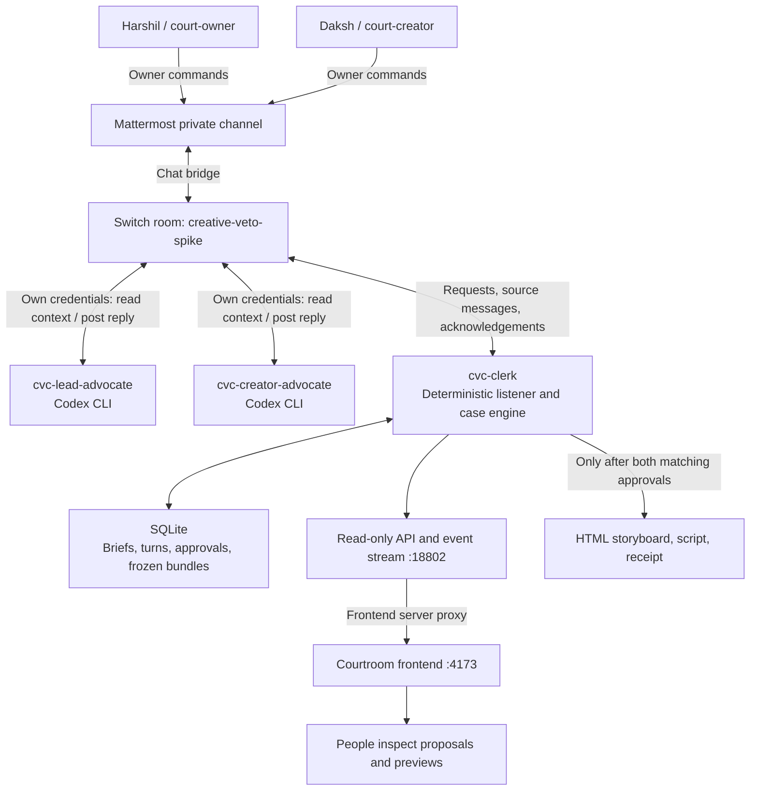

<div align="center">

# Delegates Courtroom

**Agents negotiate. Humans sign.**

Two AI advocates negotiate a creative storyboard through [Switch](https://docs.switchagents.ai/). A deterministic clerk keeps brief changes and final approval in human hands.


[Watch the demo](VIDEO_URL) · [Read the blog post](https://dev.to/harshil-sri/building-a-switch-courtroom-where-ai-can-negotiate-but-cant-consent-1g6k) · [Switch docs](https://docs.switchagents.ai/)

</div>

---

## At a glance

| | |
|---|---|
| **Built for** | Flip the Switch (WeMakeDevs x DevTools Academy x Switch), Track 2: Best Personal or Creative Workflow |
| **Side tracks** | Code with Wispr, Best Blog, #HowISwitch |
| **Team** | Harshil and Daksh |
| **Agents** | `cvc-lead-advocate` and `cvc-creator-advocate` (Codex CLI), `cvc-clerk` (deterministic Node.js, no model) |
| **Chat bridge** | Mattermost, through Switch |
| **Output** | HTML storyboard and text script (not a rendered video) |

> [!IMPORTANT]
> The recorded rehearsal uses real Switch and Codex advocate turns. It proves the mechanism works. It is not evidence that two real people reached an agreement.

## The problem

A creative lead wants a collaborator's portrait in a promo. The collaborator wants to contribute artwork but does not allow their portrait to be used. An AI assistant can suggest alternatives, but it shouldn't quietly drop either person's requirement, and it shouldn't treat its own suggestion as permission.

Delegates is for creative collaborators who want agents to handle proposals while keeping those decisions explicit.

## Try it in two minutes

No Switch, Docker or API key needed. You just need Node.js 22.13 or newer.

```sh
git clone --depth 1 --branch main https://github.com/harshil-sri/delegates.git
cd delegates
npm run dev
```

Open `http://127.0.0.1:4173/` and enter the court. Useful routes:

| Route | What you get |
|---|---|
| `/court.html?replay=1` | The recorded rehearsal, labelled as a replay |
| `/?demo=1` | The older, separately scripted hearing |
| `/` | Live mode, which reads the backend through `/api` and falls back to the labelled replay without one |

Check the project and the committed replay files:

```sh
npm run check
npm test
npm run build
npm run verify -- frontend/public/data/replay-receipt.json frontend/public/data/replay-storyboard.html frontend/public/data/replay-script.txt
```

All of these passed on a fresh clone. The replay contains synthetic owner signatures, even though the verifier's generic output calls them human approvals.

## How it works

The repo records a real rehearsal in [`docs/negotiation-live-result.json`](docs/negotiation-live-result.json). A few terms first: **H1** is the lead's brief, **D1** is the creator's brief, **BOARD1** is the first storyboard proposal, and **H2** is the lead's brief after an amendment.

| Step | What happens |
|---|---|
| **1. Conflict** | H1 requires Daksh's portrait in a four-panel, 30-second promo called SIGNAL. D1 forbids that portrait and requires the closing line `Made together. On our terms.` and the credit `Visuals: Daksh`. |
| **2. Proposal** | The lead advocate's Codex worker reads the clerk's request through Switch and posts BOARD1 under its own identity. |
| **3. Objection** | Deterministic checks catch the conflict. The creator advocate's separate Codex turn reviews that exact board and requests an amendment to H1. It does not ask to ignore D1. |
| **4. Pause** | No model runs while the owner question is pending. In this rehearsal a labelled synthetic owner fixture accepts the amendment, creating H2. |
| **5. Revision** | BOARD2 uses an object-based alternative. The creator recommends that exact revision and hash, and the encoded checks pass. |
| **6. Signatures** | Export needs both owners to approve the same bundle. The original rehearsal stops here with zero real human approvals and the live case (C01) unchanged. |

The committed browser replay adds synthetic final signatures so you can try the storyboard, script and receipt downloads. Nobody actually signed it, and its receipt verifies internal consistency, not real-world consent.

### Architecture



The frontend displays decisions but can't submit approvals over HTTP.

## How Switch is used

Switch is the backbone of the live workflow, not a wrapper around it.

### Room and bridge

The live workflow uses one private Switch room, `creative-veto-spike`, bridged to a local Mattermost instance at `http://localhost:18865/creative-veto/channels/creative-veto-spike`. The recorded negotiation check uses a separate private room, `cvc-negotiation-verification`, with an isolated database.

Two native Mattermost accounts represent the owners:

- `court-owner` owns the lead's H brief.
- `court-creator` owns the creator's D brief.

### Agents and rules

| Switch identity | Implementation | Responsibility and rules |
|---|---|---|
| `cvc-lead-advocate` | OpenAI Codex CLI worker | Propose against the current saved briefs. Preserve the lead's requirements, and never invent permission or amend either brief. Return schema-constrained JSON for exactly four panels totalling 30 seconds. |
| `cvc-creator-advocate` | Separate OpenAI Codex CLI turn | Read the lead's actual proposal through Switch. Review its exact revision and full hash against both briefs. Recommend, request a revision, request an owner amendment, or report a block. A recommendation is never human approval. |
| `cvc-clerk` | Deterministic Node.js code, no model | Consume source messages, enforce identity and command rules, schedule bounded turns, check candidates, pause for owners, and gate exports. |

Instructions and schemas are in [`agents/`](agents/). Both advocates currently use one machine's existing Codex login with separate Switch credentials, so they are not independently hosted providers. The GPT and Claude labels in the older scripted demo do not describe the live setup. The illustrated judges in the UI are presentation characters, not extra model agents.

### Message flow

[`scripts/setup-room.mjs`](scripts/setup-room.mjs) registers three external, passive HTTP identities through `/gateway/agents/register-other`, creates the room, and installs instructions that require explicitly addressed requests. Then, for each scheduled advocate turn:

1. The clerk posts a targeted request.
2. The advocate reads `/agents/{id}/ops/read_context` with its own credential.
3. The local adapter runs Codex with the current case state and response schema.
4. The advocate posts through `/agents/{id}/message`.
5. The listener reads the reply back from Switch and validates its source before committing it.

A local model response alone can't advance the case. The creator has to see the scheduled proposal in Switch, and stale or mismatched replies can't advance another turn.

Human decisions travel through the room too. Only the bound owner can adopt their brief, accept an amendment to it, or approve a bundle. Both owners must approve the same revision and complete bundle digest. New briefs or boards invalidate earlier approval targets, and owners can revoke their own approval.

### What breaks without Switch

The live workflow loses its shared room, authenticated source identities, targeted requests, advocate context and reply transport, and human decision ingestion. Negotiation can't progress, and live exports can't become approved. The static replay and offline receipt verifier still work, but they show recorded behaviour and don't replace the live workflow.

The bundled stack pins Switch core, gateway and setup to 0.31.0 and Mattermost to 11.9.0. Its Compose file comes from Switch Console 0.40.1 (see [`infra/NOTICE.md`](infra/NOTICE.md)). Switch core is not patched.

## Run the live Switch workflow

<details>
<summary><b>Show setup steps</b> (Docker, Codex login, Windows PowerShell helpers)</summary>

<br>

**Verification scope.** A fresh `main` clone at `6b1282c` was checked on Linux with Node 24.21.0, npm 11.19.0, Docker Compose 5.7.0 and Codex CLI 0.164.0. Initialization, Compose config validation, syntax checks, 113 tests, the static build, frontend route checks and committed receipt verification passed. The live stack and provider rehearsal were **not rerun** for this README, and PowerShell wasn't available, so the Windows scripts were only read through. Steps marked **(unverified)** fall in that group.

**1. Prerequisites.** Docker with Linux containers running. The background-worker scripts target Windows PowerShell. Install Codex CLI if needed **(unverified, install not rerun)**:

```sh
npm install -g @openai/codex
codex login status
```

An existing ChatGPT login was confirmed during verification. Real advocate turns use that account and may consume its allowance. Switch Console-managed agent sessions aren't required, because this project supplies its own external workers and starts the bundled Switch stack.

**2. Generate local config.** Verified. This creates an ignored `.runtime/stack.env` with generated credentials and default ports.

```sh
npm run init
```

**3. Start the stack (Windows PowerShell, unverified, source-checked only).**

```powershell
.\scripts\start-stack.ps1
```

It starts Docker project `creative-veto-spike` with the `collab` and `gateway` profiles. The Compose config validated, but image pulling and service startup were not rerun.

| Service | URL |
|---|---|
| Switch API | http://localhost:18800 |
| Switch dashboard | http://localhost:18801 |
| Mattermost | http://localhost:18865 |
| Clerk case page and API | http://localhost:18802 |
| Courtroom frontend | http://127.0.0.1:4173 |

**4. Register agents and initialize the case (unverified, needs the live stack).**

```powershell
npm run setup
npm run setup:engine
```

Setup saves agent credentials in the ignored `.runtime/room.json`. Engine setup creates and binds the owner accounts and initializes case C01. Dashboard credentials are `GATEWAY_ADMIN_EMAIL` and `GATEWAY_ADMIN_PASSWORD` in `.runtime/stack.env`. The `court-owner` Mattermost password is `MATTERMOST_USER_PASSWORD` in the same file, and `court-creator`'s credentials are in `.runtime/court-users.env`. Keep `.runtime/` private, and don't regenerate credentials over existing database volumes.

On Windows the adapter finds a standard npm Codex install. If yours is elsewhere, set `CVC_CODEX_CLI` to the executable or `codex.js` path before starting the workers.

**5. Start and inspect the workers (unverified, live startup not rerun).**

```powershell
.\scripts\start-workers.ps1
npm run status
```

Or run the listener in the foreground instead, but use one or the other, not both **(unverified)**:

```sh
npm run listen
```

Then run `npm run dev` in another terminal.

**6. Walk through the human workflow (unverified, not done with real owners yet).** Open the case page and the Mattermost channel, using separate browser profiles for the two accounts.

- Each owner reviews their brief and posts its displayed **ADOPT** command.
- The advocates propose and review the first board.
- Only `court-owner` accepts or declines the proposed H amendment.
- After the revision and recommendation, both owners inspect the frozen preview.
- Each owner posts the displayed **APPROVE** command for the same digest.

Don't reuse hashes from screenshots or make up commands. The case page shows the current exact commands, and one approval doesn't unlock export.

**7. Optionally rerun the recorded verification (unverified).**

```sh
npm run check:negotiation
```

This runs real Codex turns through Switch in an isolated verification room. The owner adoption and amendment inputs are explicitly synthetic, so it does not collect real human approvals. To stop the Windows background workers, run `.\scripts\stop-workers.ps1` **(unverified)**.

</details>

## Repository structure

<details>
<summary><b>Show file map</b></summary>

<br>

```text
agents/                         Advocate instructions and JSON response schemas
infra/compose.yml               Pinned upstream Switch and Mattermost stack
infra/NOTICE.md                 Stack provenance and version information
scripts/setup-room.mjs          Register identities, create room, install policies
scripts/setup-engine.mjs        Bind owners and initialize the persistent case
scripts/listen.mjs              Start room ingestion, workers and read-only API
scripts/check-negotiation.mjs   Isolated real Switch and Codex rehearsal
src/switch-client.mjs           Switch context-reading and message-posting adapter
src/codex-provider.mjs          Schema-constrained Codex CLI invocation
src/court-engine.mjs            Ownership, amendments, approvals and SQLite state
src/negotiation.mjs             Bounded proposal and review scheduling
src/storyboard.mjs              Encoded checks and deterministic bundle rendering
src/receipt-verify.mjs          Offline receipt and file-consistency checks
frontend/server.mjs             Static frontend server and read-only API proxy
frontend/public/court.mjs       Integrated live and replay courtroom client
frontend/public/data/           Committed recording and synthetic-signature exports
assets/                         Fixed storyboard asset catalog
test/                           Automated regression tests and browser runners
docs/automatic-negotiation.md   Protocol, recorded evidence and verification limits
```

</details>

## How it was built

We used OpenCode and AI coding agents to help implement, review, debug and test the project. The runtime advocates are separate Codex CLI workers, not the coding agents that built the app.

The build went from a real Switch and Mattermost round trip, to persistent owner mandates, exact-bundle approval and bounded negotiation, and finally the integrated courtroom display. Recorded evidence and protocol notes live alongside the code.

For the Code with Wispr side track, we used [Wispr Flow](https://wisprflow.ai/) to dictate prompts, agent instructions and documentation. Voice dictation was part of building the project, not a runtime speech feature. For the full story, read the [blog post](https://dev.to/harshil-sri/building-a-switch-courtroom-where-ai-can-negotiate-but-cant-consent-1g6k).

## Limitations and what's next

| Limitation | What's next |
|---|---|
| **Recorded consent is synthetic.** The rehearsal proves message flow and negotiation, not a finished agreement between two humans. | Record the full workflow with both real owners approving the same bundle. |
| **One machine, one provider login.** Both advocates use the same Codex account, and briefs are shared in the room. | Independently owned advocate workers and private chambers. |
| **Narrow creative scope.** A four-panel, 30-second storyboard and script from a fixed asset catalog. No video, and no legal or wider creative review. | Broader asset catalog and rendering. |
| **Local trust and deployment limits.** The Windows helpers and pinned stack need a fresh end-to-end rerun. Receipts check consistency, not cryptographic proof of identity or an independently authenticated Switch history. | A full rerun on a clean machine and stronger receipts. |

## Team

Built by **Harshil** and **Daksh** for Flip the Switch, hosted by WeMakeDevs and DevTools Academy.
