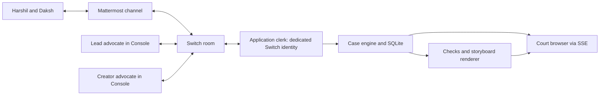

# Creative Veto Court: complete demo and backend design

Design draft, 7 November 2026, India time. Prepared before implementation. The examples below are a proposed demo script, not a transcript of a working run. This document develops Creative Veto Court; it does not establish that the required Switch configuration has passed a runtime test.

**Integration milestone, 7 November:** The user authorized the Switch spike and it is now implemented. See [setup and current runtime](C:/Users/iamda/Desktop/Switch/README.md), [the real round-trip evidence](C:/Users/iamda/Desktop/Switch/docs/spike-result.md), and [automatic worker verification](C:/Users/iamda/Desktop/Switch/docs/live-listener-result.json). The tested path uses pinned Switch core 0.31.0, Mattermost, two headless Codex CLI advocate workers, and a passive HTTP clerk. Console sessions are not required for this tested adapter.

**Mandate engine milestone, 7 November:** Owner binding, brief adoption and versioning, amendment requests/decisions, deterministic board checks, frozen HTML/script bundles, two-human same-bundle approvals, revocation and the read-only case page are implemented. See [the implemented protocol and verification](C:/Users/iamda/Desktop/Switch/docs/mandate-engine.md). The live case awaits the real owners' decisions; no live human approval was simulated.

**Automatic negotiation milestone, 7 November:** Strict lead proposals, exact-board creator reviews, two-proposal scheduling, owner amendment pauses and automatic revision/preparation are implemented. See [the protocol and isolated real-agent rehearsal](C:/Users/iamda/Desktop/Switch/docs/automatic-negotiation.md). Rehearsal owner inputs are explicitly synthetic in a separate database; live C01 remains untouched by that check. The remaining sections preserve the earlier design proposal. The full court presentation remains future work.

## Intended outcome

Two real collaborators use their existing agents in a shared Switch room to resolve a creative disagreement. Each person explicitly approves the rules their advocate represents. The result is an exported four-panel storyboard and script, bound to the exact revision both people approved.

Working pitch: **“Your agent can negotiate the creative work. You keep authority over your terms.”**

The first implementation uses one room, two human chat accounts, two advocate agents, and a small deterministic clerk service. A judge character in the UI can announce the clerk's actual checks. A third LLM judge is optional and is not part of the recommended minimum.

## Working assumptions

- Harshil plays the creative lead; Daksh plays the collaborating creator. These are demo roles, not assertions about their real preferences.
- The fictional project is a 30-second promo for **SIGNAL**, a student creator showcase. It is not a real campaign, booking, or customer engagement.
- The initial artifact is a four-panel storyboard and Markdown script with declared durations. It is a production plan, not a completed 30-second film.
- Use a small catalog of original sample assets. No live image generation, outside media search, or actual portrait is needed for the first case.
- Both briefs deliberately contain information each owner agrees to share. Reasons behind a person's boundary stay outside this demo.
- One local backend process, one case per room, two configured humans, and a short room history are sufficient. Public hosting and multiple organizations are outside this draft's implementation target.
- Proposed stack: TypeScript/Node, a small HTTP framework, schema validation, SQLite, and SSE to the browser. Choose a different familiar stack before implementation if it makes the team faster.
- Target browser updates within roughly 2–3 seconds after a stored room message, using a poll about every 2 seconds. Model turns may take longer; measure them during the first real run.
- Persist case state and decisions so a backend restart does not invent a new case or repeat an approval. An unavailable agent or incomplete room sync pauses progress.
- Keep a thin Switch adapter and record compatible Console/server versions. The two builders own the small app and its setup documentation; no Switch-core modification is planned.

## The exact case

### Harshil's approved brief, H1

- **Must protect:** the initial storyboard must include the collaborator's portrait; include the event name SIGNAL.
- **May negotiate:** opening shot, colors, wording apart from required copy, and placement of the visual reveal.
- **Must ask:** replacing the portrait with an object-based visual treatment. Only Harshil may change this requirement.
- **Goal:** the promo should feel personal and energetic.

### Daksh's approved brief, D1

- **Must protect:** do not use the sample portrait asset in this promo.
- **Must protect:** the final board contains the exact line **“Made together. On our terms.”** and credit **“Visuals: Daksh”**.
- **May negotiate:** object illustrations, text treatments, scene order, and palette within the approved asset catalog.
- **Goal:** contribute a recognizable creative voice while keeping the stated portrait-use boundary.

### Shared project rules

- Exactly four panels.
- Positive whole-second planned durations totaling 30 seconds.
- Only registered, approved assets in a candidate accepted for export.
- All required copy is present.
- Both configured humans approve the current revision after seeing its rendered preview.

The initial portrait rules genuinely conflict. The system must not silently recast either one as a preference. It should identify that conflict and help the people find a change they are willing to make.

### Sample asset catalog

| ID | Content | Use in this case |
|---|---|---|
| `portrait-daksh` | Metadata for a fictional portrait proposal; a blocked placeholder can be shown | Denied by D1; actual portrait bytes are unnecessary |
| `signal-mark` | Original text/logo treatment for SIGNAL | Approved |
| `notebook` | Original notebook drawing | Approved |
| `hands-sketch` | Original hands-and-paper drawing | Approved |
| `light-trails` | Original abstract illustration | Approved |

An agent selects IDs and writes captions; it does not supply arbitrary URLs, SVG code, HTML, or executable rendering instructions. The application owns the assets and renderer. This makes the actual exported asset selection checkable. It does not turn the app into a general image-content verifier or a legal-rights adjudicator.

## Full demo walkthrough

### 1. Both people adopt their briefs

The court displays the two brief cards and their owners. Each person reviews their own card, then confirms it from their real Mattermost account. The clerk observes the messages through Switch and records the brief revision and source message ID.

For a first implementation, the UI can display a short command to copy into chat, such as `ADOPT C01 H1`. The server accepts it only from the configured owner of H1. A button on the court web page cannot send a clerk message and count it as a human's adoption.

An optional one-question preview of an advocate's behavior can help the owner check the brief. It is not proof of complete preference understanding and can be cut from the first demo.

### 2. The lead's advocate proposes board 1

Illustrative advocate message: “The brief requires a personal introduction. I propose a portrait reveal in panel 2, followed by the event identity and final line.”

The agent posts a concise explanation and a structured board in the shared Switch room. The clerk ingests the actual message, binds it to its actual sender and expected turn, allocates board revision 1, and runs checks.

Board 1 fails the portrait-use rule. The court shows the rejected asset reference and D1 as the reason. The renderer uses a blocked placeholder instead of displaying a prohibited portrait. The agent has followed its own lead's requirement, but that proposal cannot satisfy both people.

### 3. The creator's advocate offers an alternative

Illustrative advocate message: “The portrait is outside my owner's approved use. We can preserve the personal feel with hands, a notebook, and a sequence of ideas taking shape. Harshil needs to approve replacing the portrait requirement.”

This is an amendment request, not authorization to change H1. The app shows two linked facts: board 1 violates D1, and the proposed object-based treatment would require Harshil to change H1.

### 4. The clerk asks one exact human question

The court enters **NEEDS_HUMAN** and stops scheduling more advocate turns.

The clerk posts in the room: “Harshil, allow the object-based treatment to replace your portrait requirement for C01? Daksh's portrait-use rule stays in force.”

The first implementation can offer an exact reply such as `CHOOSE C01 OBJECTS`. It maps to one stored decision request and one explicit change. The backend accepts it only from Harshil's bound chat identity while that request is current. General conversational replies remain visible without silently changing rules.

Harshil chooses the alternative. The clerk records H2: the portrait requirement is removed and an object-based visual treatment is allowed. D1 remains the same. This human action resolves the conflicting requirements.

If Harshil declines, the case remains unresolved or ends with NO_AGREEMENT. The moderator cannot override either person.

### 5. The advocates develop board 2

The clerk addresses the lead's advocate with H2 and D1 and asks for a complete revised board. The creator's advocate then reviews it and may request a correction. Its review is a recommendation, not the human's final approval.

A concrete target board:

| Panel | Planned duration | Asset | On-screen material |
|---|---:|---|---|
| 1 | 6 seconds | `signal-mark` | SIGNAL; an idea begins |
| 2 | 8 seconds | `notebook` | A blank page and a first attempt |
| 3 | 9 seconds | `hands-sketch` | Different contributions making one piece |
| 4 | 7 seconds | `signal-mark` | “Made together. On our terms.” and “Visuals: Daksh” |

The narrative and wording can be model-generated; the durations and assets above are sample inputs. The sum is 30 seconds. The actual accepted output is whatever current board the people see and approve, not a prewritten board substituted for the agents' result.

### 6. Checks pass and the actual preview is built

The application checks schema, asset permissions, four-panel count, required copy, and the duration sum. Then it renders the preview from the structured board and registered assets.

Prepare the exact downloadable artifact before asking for final approval. Record the board content, active brief versions, asset byte hashes, renderer version, and rendered artifact digest as one approval bundle. The preview is the bundle being reviewed.

The court enters **AWAITING_APPROVALS** only after these steps succeed. It shows “Harshil: pending; Daksh: pending.”

### 7. Both humans approve board 2

Each person sends a short message such as `APPROVE C01 BOARD2` from their actual chat account. The app binds that message to the immutable current approval bundle. A digest can remain an internal detail; board revisions are never reused.

One approval is insufficient. An advocate saying “my owner approves,” a message from the clerk, or a quoted approval does not count. The court changes to APPROVED only when both configured human identities have approved the same current bundle.

### 8. Export and receipt

The app serves the already rendered storyboard and a script/receipt. The receipt includes C01, board revision, brief versions, check results, artifact digest, the human approval message references, and the selected creative change.

It can say: “The portrait requirement was changed by Harshil. The accepted board uses the approved object artwork. Both collaborators approved board 2.” It should not claim a film was produced or a real campaign was published.

Optional later moment: a new brief or asset-policy revision makes the current approval bundle stale and blocks a fresh official export until rechecked and approved. Old downloaded files and historical receipts cannot be retroactively revoked; preserve their history accurately.

## Architecture



### Switch owns

- The shared conversation, bridged chat identities, room membership, and agent addressing.
- Delivery to the advocates that Console runs through the team's chosen existing providers.
- The source messages from which we derive proposals and human decisions.

### Our application owns

- Brief revisions, the current case, expected turns, check results, and human-decision requests.
- The mapping from approved human briefs to their advocates.
- The local asset catalog, renderer, preview bundle, and export.
- The read model and animation events for the court browser.

### The advocates own

- Explaining their person's goals, proposing creative work, objecting with a specific rule reference, and developing alternatives.
- They cannot directly record a human approval, mutate an accepted brief, or mark a case approved.

Switch is central to the human/agent interaction. The court web page is the display and artifact surface; the MVP's actual human decisions happen in chat.

## Verified source interfaces and runtime gates

Source was inspected on 7 November. The installed release still needs a runtime spike. These are agent-bridge paths relative to its actual configured base URL, not a guessed Gateway URL.

### Read messages

`POST /agents/{clerk_id}/ops/read_context`

Proposed request body: `{"room_id":"<shared-room-id>","limit":200}` with the clerk's agent bearer credential.

The operation can read an explicitly named room when the agent is a member. It returns threaded entries with message IDs and sender metadata. The HTTP operation response wraps that data under `result`. [Operation definitions](https://github.com/sandbox-quantum/switch/blob/main/core/switch_core/bridges/agent/operations/definitions.py), [HTTP adapter](https://github.com/sandbox-quantum/switch/blob/main/core/switch_core/bridges/agent/api/operations.py)

For this short dedicated room, reread the bounded case history and deduplicate stable message IDs. Flatten roots/replies and skip elided stubs. If the response is truncated, retrieve the missing history or enter SYNC_INCOMPLETE and pause; never silently process a partial case. Overlapping windows and timestamps are not substitutes for message IDs. The older history response drops those IDs, so it is a poorer source for the clerk. [API handlers](https://github.com/sandbox-quantum/switch/blob/main/core/switch_core/bridges/agent/api/handlers.py)

### Write clerk notices and turn prompts

`POST /agents/{clerk_id}/message`

Proposed request body: `{"room_id":"<shared-room-id>","content":"@lead-advocate <the current turn prompt>"}`.

This lower-level endpoint names the room explicitly. The current targeted-send implementation constructs named mentions and sends them through the same message path. Confirm that the installed version's addressing policy actually wakes the intended advocate. [Message endpoint](https://github.com/sandbox-quantum/switch/blob/main/core/switch_core/bridges/agent/api/handlers.py), [Targeting implementation](https://github.com/sandbox-quantum/switch/blob/main/core/switch_core/bridges/agent/protocol/agent_core.py)

When using a provider agent's MCP tools, use `send_targeted_message` for an addressed handoff and `post_message` for a broadcast. The targeted operation requires a room-bound session; explicit-room history reading and the lower-level message endpoint allow a simpler polling clerk. Do not fabricate a connection ID to bypass binding. [Operation definitions](https://github.com/sandbox-quantum/switch/blob/main/core/switch_core/bridges/agent/operations/definitions.py)

### Clerk identity

Propose a dedicated passive agent identity whose only job is polling and posting as the clerk; it needs no language model. Register it out of band through the installed server's supported registration flow and add it only to this room. Keep its API credential in the backend environment. Do not reuse a running advocate's credentials or take over its session.

Registration and ordinary agent calls use different credential purposes. Obtain the actual bridge URL from the configured deployment and verify it, rather than assuming it equals the operator dashboard URL. [Protocol notes](https://github.com/sandbox-quantum/switch/blob/main/docs/official/internals/agent-protocol.md)

Console can continue to handle the advocates' transport and sessions. Our clerk does not need to implement Switch's full socket/heartbeat lifecycle for this design. Validate the chosen passive read/write path first; if the installed version refuses it, revise the adapter before building the full UI.

## Identity and source of authority

Bind two actual human accounts and the two actual advocate senders during trusted setup. Use complete opaque sender IDs from the bridge. A database participant UUID, a display name, and a timeline sender ID are not automatically interchangeable.

Verify each binding using the known signed-in chat account and an observed setup message; store the binding out of band. A participant cannot become Harshil by typing his name. The app must not self-enroll approvers from arbitrary room text.

Timeline messages can also be platform-authored or speak on behalf of someone; those are not direct approvals from the configured human account. [Timeline implementation](https://github.com/sandbox-quantum/switch/blob/main/core/switch_core/bridges/agent/protocol/agent_core.py)

The approval parser checks trusted room, sender, exact command, active case, current revision, current brief/asset versions, successful checks, and prepared preview. Never derive authority from a `speaker` property or an `approved=true` value in model output.

## Agent response contract

Each scheduled turn asks for a short ordinary explanation followed by a clearly marked structured block. The app accepts structured actions only from the expected agent for the current turn. The following is our proposed data contract, not a Switch-native event type:

```json
{
  "case_id": "C01",
  "turn_id": "lead-2",
  "kind": "board_proposal",
  "base_revision": 1,
  "brief_versions": {"lead": 2, "creator": 1},
  "panels": [
    {
      "duration_seconds": 6,
      "asset_id": "signal-mark",
      "caption": "SIGNAL",
      "narration": "Every idea starts somewhere."
    }
  ]
}
```

This abbreviated example omits the other three panels and is not itself a valid full board. The server allocates the new revision. Separate action kinds can request an amendment or review a board; none can grant approval on a human's behalf.

Use typed schema validation. Unknown assets, malformed data, stale brief versions, or an unexpected sender do not advance the case. Keep the original source message and a readable explanation in the timeline. Allow one targeted repair request for malformed output, then show a blocked turn rather than looping indefinitely.

## Case states and turn control

`INTAKE → NEGOTIATING → NEEDS_HUMAN → NEGOTIATING → PREPARING_PREVIEW → AWAITING_APPROVALS → APPROVED`

The demo allows two rounds: lead proposal, creator objection, human amendment if needed, revised lead proposal, creator review. The clerk schedules one expected speaker at a time. Both advocates are instructed to respond only to the clerk's addressed turn requests; broadcast check results do not invite more responses.

The engine accepts at most one state-changing action for a turn. Out-of-turn chatter can remain visible without changing the board. This controls our workflow; it is not a claim that a prompt can physically prevent every extra agent message.

Explicit side states include BLOCKED_AGENT, SYNC_INCOMPLETE, RENDER_FAILED, and NO_AGREEMENT. A timeout never becomes consent. A rejected board returns to negotiation or a specific human question. Cancellation ends the case without an approved artifact.

Changing a brief, board, or relevant asset invalidates the current approval bundle. Earlier approvals remain in history but cannot count toward the new one. Even if a revised board has identical text, a changed rule or asset binding requires a new review bundle.

## Local records

| Record | Essential data |
|---|---|
| Case | ID, trusted room, configured actors, status, current brief/board versions, expected turn |
| Brief version | Owner sender ID, structured rules, version, adoption/amendment source message |
| Asset | Stable ID, case permission, owner/policy source, file digest |
| Inbox message | Server/room/message identity, opaque sender ID, body, timestamps, processing result |
| Turn / outbox | Intended actor, turn ID, prompt, send status, observed Switch message ID |
| Board version | Source agent message, normalized panels, active brief/asset bindings, check results |
| Approval bundle | Board, briefs, asset digests, renderer version, preview bytes/digest |
| Human decision | Actor, action, exact target bundle/request, source message ID, timestamp |
| App event | Local ordered event ID and the state/display change it represents |

SQLite transactions and uniqueness constraints handle duplicate messages and competing local changes. One poller and one mutation path are enough for the MVP. Switch remains the source for conversation; our database persists the case-specific interpretation and immutable approval bundles.

## Sending, retrying, and recovering

Persist an intended prompt before sending it. Include a turn/dispatch identifier in the prompt so it can be reconciled with room history. If an HTTP send times out, its commit status can be uncertain; read the room before retrying. Do not assume the upstream endpoint guarantees idempotent sends.

Even if a prompt or reply is delivered twice, the same turn cannot apply two actions. On backend restart, reload SQLite, reconcile the room, and resume from the stored state rather than reposting every prompt.

A successful API send is not proof the model responded. Record actual source replies. If the agent is unavailable, not permitted, or produces no valid reply within the turn's configured timeout, pause and show why. The installed version's permissions and provider latency must be measured during setup.

## Rendering and browser events

Render only a structured board into an application-owned template. Escape text; select assets by catalog ID; do not evaluate model-provided code or load its arbitrary URLs/paths. Generate the exact preview/export files once per bundle.

The browser reads a case snapshot and an SSE stream of our persisted app events. On reconnect it resumes after its last local event ID, or reloads the snapshot if required. It never receives the clerk credential.

Example app events: `brief_adopted`, `proposal_received`, `check_failed`, `human_needed`, `brief_amended`, `preview_ready`, `approval_recorded`, and `artifact_approved`. Their types belong to our app; they are derived from actual Switch messages and local checks.

Suggested read routes:

- `GET /api/cases/C01` — current snapshot.
- `GET /api/cases/C01/events` — browser SSE.
- `GET /api/cases/C01/boards/2/preview` — the actual review preview.
- `GET /api/cases/C01/boards/2/export` — official download after current approvals and checks pass.

Seed/setup commands are local operator actions. The MVP does not expose a public browser endpoint that can approve as someone else. Future in-app approvals need a properly linked human identity; a backend bot posting a person's name is insufficient.

The official export gate cannot stop someone manually copying a preview they can see. Its job is to label and serve the approved revision accurately, not provide content DRM.

## Acceptance criteria before calling the demo complete

1. Two actual human accounts and two advocate agents participate in the intended Switch room. Trusted sender bindings are verified against the bridge.
2. The clerk can read stable message IDs and post a targeted prompt with the installed version. The intended advocate actually replies.
3. Board 1 fails the portrait rule and cannot become the approved export. An unknown asset or missing estimate/copy does not silently pass.
4. Only Harshil can amend H1; that action produces H2 and the source reference. The court does not advance automated turns while awaiting him.
5. Board 2 has four panels, approved assets, required wording and credit, and durations totaling 30 seconds.
6. The preview is built before the two final approvals. Wrong sender, quoted command, agent endorsement, duplicate message, or one human approval cannot close the case.
7. A changed brief/asset/board cannot reuse old approvals. A stale approval command cannot approve a newer revision.
8. A send timeout, provider failure, truncated history, renderer failure, refresh, or restart produces an honest status and preserves the case. Duplicate delivery does not apply a turn twice.
9. Downloaded approved bytes match the bundle that was reviewed. The receipt's source messages and actor IDs agree with the actual room history.

These are proposed product checks for implementation, not tests already executed. No application code has been written in this design step.

## Build order after design review

1. **Switch integration spike:** get the chosen Console/server setup and Mattermost running; connect advocates; establish human identities; register the clerk; prove one actual read and targeted reply. Pin versions.
2. **Case engine first:** implement the sample rule conflict, human-owned amendment, board revisions, validation, and approvals with a plain transcript display.
3. **Real agent proposals:** enforce the response schema and two-round limit; complete a whole case through Switch.
4. **Artifact preview/export:** render the accepted board using original known assets; bind approvals to the actual preview bundle.
5. **Court presentation:** add speaker states, a conflict banner, check results, approval indicators, and modest character animation.
6. **Reproduction and recording:** reset to a fresh case, run the documented setup, record real messages and the export, and label any illustrative editing/replay.

The first source-checkable integration is not a substitute for the runtime spike. If the clerk path fails on the installed release, solve that adapter issue before investing in the full court scene.

## Decision log for review

| Proposed decision | Alternative considered | Reason |
|---|---|---|
| Two advocate LLMs plus a deterministic clerk | Add separate judge and clerk LLMs | Fewer calls and a clear source of authority for encoded checks |
| Existing agents via Console | Build custom provider runtimes | Keep Switch's existing agent/session support and reduce integration work |
| Poll explicit room context for the short case | Implement a custom Switch push client | Avoid implementing the full connection lifecycle before the demo |
| Human commands in actual chat accounts | Approve through a bot message from the web UI | Preserve who actually made the decision |
| Known original assets and template renderer | Generate unrestricted images for every revision | Make exported asset selection inspectable and keep scope small |
| Immutable reviewed bundle | Render fresh output after approval | Keep the reviewed and downloaded content aligned |
| Shared, explicitly approved briefs | Two private chambers per advocate | Demonstrate consent without relying on unverified cross-room secrecy |

Open implementation choices: the team's fastest language/provider setup, actual server version and registration flow, trusted account-to-sender bindings, timeout values measured from real turns, and the final visual style. These do not prevent review of the proposed scenario.

## Primary references

- [Switch operation definitions](https://github.com/sandbox-quantum/switch/blob/main/core/switch_core/bridges/agent/operations/definitions.py)
- [HTTP operation adapter](https://github.com/sandbox-quantum/switch/blob/main/core/switch_core/bridges/agent/api/operations.py)
- [Agent API handlers](https://github.com/sandbox-quantum/switch/blob/main/core/switch_core/bridges/agent/api/handlers.py)
- [Message, targeting, and timeline implementation](https://github.com/sandbox-quantum/switch/blob/main/core/switch_core/bridges/agent/protocol/agent_core.py)
- [Checked-in agent protocol notes](https://github.com/sandbox-quantum/switch/blob/main/docs/official/internals/agent-protocol.md)
- [Example agent/room template](https://github.com/sandbox-quantum/switch/blob/main/examples/agent-templates/triage-pair.template.yaml)

All `main` links are moving references. Record the exact compatible installed release/commit when the integration is tested.
